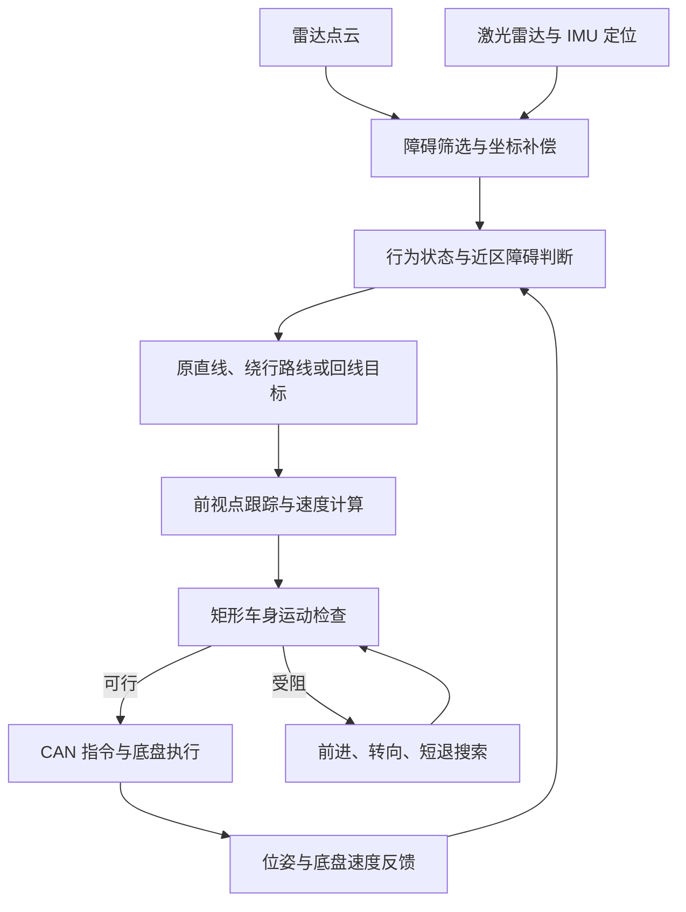
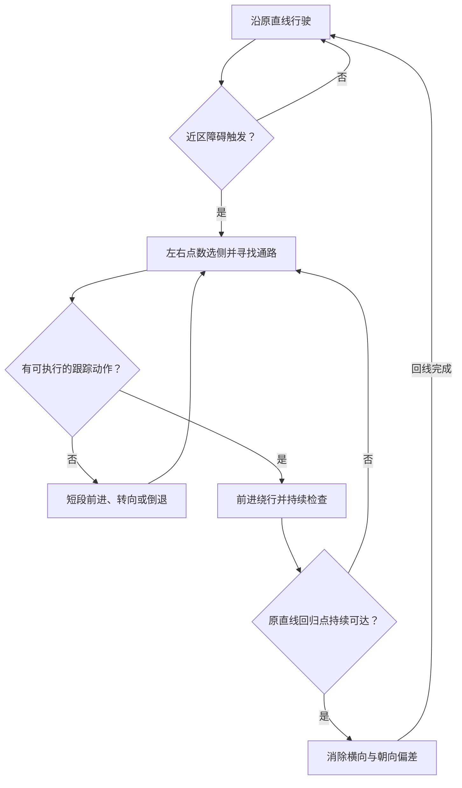

# 实验三：环境感知、避障方法与技术路线

_当前版本，2026-11-14。依据实验书、实际调用代码与最近部署检查记录整理。_

## 实验目标与方法

按照[实验任务书](实验三+轮式机器人环境感知与避障方法.docx)第 3.3、3.4 节和图 4.1、4.2，机器人需要根据定位和激光雷达数据判断障碍方向，再通过有限状态机切换正常行驶与探索绕行。检测区位于车头前方，长 1 m、总宽 0.70 m。发现障碍后，先比较左右点云数量，选择初始探索方向。

本实验在上述方法中加入带代价的局部栅格搜索和连续路线跟踪，并设置短退脱困、回线控制。任务开始时，将车头正前方 10 m 处设为固定目标。机器人先沿直线前进，遇到近区障碍后绕行，通路允许时尽早回线，最后在目标附近恢复初始朝向。这里的 10 m 指起终点直线距离，绕行增加的路程不计入到达条件。固定 10 m 目标、回线和短退属于本次实验的扩展要求。

状态机负责切换行驶行为，A* 搜索生成路线。跟踪控制器据此计算线速度和角速度，矩形运动检查筛选可执行的动作。路径代价由人工设定，系统不涉及训练或强化学习奖励。

在前端选择“实验三”，切回网络/CAN 模式并取得控制权，先“准备实验”，再“开始实验”。起点与目标在开始时固定，暂停、继续保留目标，停止后重新准备。界面显示直行、绕行、回线、受限位置前进、转向或倒车等当前状态。

### 系统技术路线

雷达与 IMU 驱动、FAST-LIO 定位节点由[传感器启动配置](../实验二/lab26/launch/sensors.launch)组织，导航模块直接使用上游的激光惯性定位结果。控制器订阅 `/velodyne_points` 与 `/Odometry`，按 50 Hz 的目标循环频率更新状态和输出。实际传感器更新频率和计算耗时可能不同。

| 层次 | 当前方法 | 输出 |
| --- | --- | --- |
| 感知与定位 | 雷达点云筛选、上游激光惯性定位、点云坐标补偿 | 障碍点与机器人位姿 |
| 行为决策 | 直行、绕行、回线、恢复、终点回正等状态切换 | 当前行为与目标 |
| 路线规划 | 0.10 m 栅格、八邻域 A*、矩形通行检查、直连简化 | 路线折点 |
| 跟踪控制 | 前视点、航向反馈、角速度阻尼、线角速度协调 | 目标线速度与角速度 |
| 执行检查 | 矩形车身沿反应和制动轨迹的运动区域检查 | 可执行指令或恢复动作 |
| 底盘通信 | ROS 控制循环、CAN 收发 | 底盘执行与速度反馈 |

实际调用链是 `start3 → Motion::start() → Motion::step() → Navigator::step()`。`navigation.cpp` 实现导航；共享 `motion.h` 管理起点坐标、暂停和任务状态；`basic_control.cpp` 处理 ROS、CAN 与前端通信。`control_core.cpp` 参与编译，其中的探索控制类不在当前 `start3` 的主控制路径上。核对运行参数时，应查看实际调用的导航代码。

### 遇障后的行驶过程

1. 沿原直线向初始朝向前方 10 m 的目标行驶。前方较远处有障碍时，可以提前减速。
2. 车头前方 1 m 检测区内出现至少 3 个点后，比较左右点数。左侧少则优先左绕，否则优先右绕；点数相等时偏右。
3. 按初选侧寻找通路，再通过矩形检查判断是否可行。规划方向与初选侧没有明显冲突时，增强起始转向，避免继续贴近障碍。
4. 一边前进一边跟踪绕行路线，检查前后角和侧边随车身转动扫过的区域。已有路线可行时继续沿用。
5. 跟踪动作受阻时，尝试低速前进、两侧转动或短退。后退约 10 cm 或达到该段时间限制后，优先转向找路。
6. 原直线上的回归点持续可达时，朝该点消除横向偏差。位置和朝向都进入允许误差后，恢复正常沿线行驶。
7. 接近固定终点后减速，在目标附近恢复初始朝向，待底盘反馈低速稳定后结束。

例如，障碍位于原直线上，右侧点更多，机器人会先尝试左绕。接近时减速，触发后边前进边左转，沿障碍左侧通过，再朝原直线上可达的回归点行驶。如果左侧封闭，就需要换侧或短退转向。这个例子只说明行驶顺序，实际路线仍由当时的点云决定。

图中循环表示持续检查通路，重规划的时机见“路径搜索与回线”一节；终点处理见“路线跟踪与速度控制”一节。

## 坐标与感知

控制器在任务开始运行时记录起点位姿 $(x_0,y_0,\psi_0)$。当前位姿为 $(x,y,\psi)$，将其转换到以起点为原点、初始车头方向为横轴的坐标系：

$$
\begin{bmatrix}x_r\\y_r\end{bmatrix}
=\begin{bmatrix}\cos\psi_0&\sin\psi_0\\-\sin\psi_0&\cos\psi_0\end{bmatrix}
\begin{bmatrix}x-x_0\\y-y_0\end{bmatrix}.
$$

朝向记作 $\psi_r=\operatorname{wrap}(\psi-\psi_0)$，其中 `wrap` 把角度归一化到 $[-\pi,\pi]$。目标始终是 $(10,0)$，原路线为 $y_r=0$；$x_r$ 表示沿原方向进度，$y_r$ 表示横向偏差。到目标的距离为 $r=\sqrt{(x_r-10)^2+y_r^2}$。绕障累计路程通常超过 10 m，不影响目标位置。

点云处理先滤掉非有限值点、车身内部点及雷达坐标下 `|z|>0.35 m` 的点，再保留平面半径小于 6 m 的外部点，取其二维坐标。处理采用固定高度截取，未做地面分割和障碍物分类。

按任务书图 4.1，车身模型长 0.65 m、宽 0.55 m，雷达居中。规划与执行共用 0.67 × 0.58 m 的检查矩形，相当于前后各加 1 cm、左右各加 1.5 cm。这些尺寸来自代码中的模型，未涵盖对全部外露结构的重新测量。

两帧雷达之间，用点云接收时位姿 $(t_s,\psi_s)$ 与当前位姿 $(t_c,\psi_c)$ 补偿旧点坐标：

$$p_c=R(\psi_s-\psi_c)p_s+R(-\psi_c)(t_s-t_c).$$

$R$ 为二维旋转矩阵。该步骤补偿车体运动，假设障碍在两次处理之间静止；没有逐束运动去畸变，也没有估计障碍运动速度。

规划器将点转换到起点坐标后，按 0.10 m 格子聚合。本格及周围八格合计至少 3 个点时，保留本格最后记录的点作为代表点，以减少孤立噪点；代表点不取质心。车身运动检查使用另一份数据，即经过高度和车身过滤的原始平面点。

图 4.1 的检测区从车头前缘向前延伸 1 m，总宽 0.70 m。居中雷达到车头前缘为 0.325 m，因此触发条件是：

$$N=\sum_i\mathbf{1}(0.325<x_i\le1.325,\ |y_i|\le0.35)\ge3.$$

正常沿线状态下，远处点云不会单独触发选侧绕行。障碍进入车头前 1 m 区域后，记录触发朝向 $\psi_e$ 和初选侧 $s_e\in\{-1,1\}$，建立 $\psi_e+s_e\times0.60$ rad 的初始朝向参考。近区仍有障碍、参考朝向尚未达到，且规划方向没有明显反对初选侧时，如果当前转角偏小，就用这个参考增强转向，避免沿近似切线逼近障碍。约 34° 的偏角用于起始引导，机器人在前进中调整方向，无需先停稳，也无需固定转完这个角度再直行。转向增益仍为 1.45；参考角决定转向目标，增益决定追踪目标的力度。

若运动检查在到达近区前发现动作不可行，控制器也会进入恢复状态，此时可能改变方向。

## 路径搜索与回线

首先检查当前位置能否沿直线到达目标，矩形通行检查通过则直接采用该段。需要搜索时，在 $x_r\in[-0.5,11]$、$y_r\in[-4,4]$ 内用 A* 搜索 0.10 m 八邻域网格，每一步按行进朝向检查 0.67 × 0.58 m 矩形是否可通过。搜索优先级为：

$$f(n)=g(n)+h(n),\qquad h(n)=\|p_n-(10,0)\|_2.$$

$g$ 累计路程与代价：靠障碍越近代价越大，偏离原路线增加少量代价，改变已经选择的绕行侧也增加代价。代码中的一步代价为：

$$\Delta g=\Delta s\left[1+\frac{0.12}{\max(0.08,d_o-r_b)}+0.25|y_r|+c_s\right]+0.05(1-\cos\Delta\theta),\qquad r_b=\sqrt{0.325^2+0.275^2}\approx0.426.$$

$\Delta s$ 是相邻格点间距，$\Delta\theta$ 是相邻网格步的方向变化，首步不加转折项。各项作用如下：

| 代价项 | 作用 |
| --- | --- |
| 路程 $\Delta s$ | 减少不必要的绕远 |
| 障碍接近项 $0.12/\max(0.08,d_o-r_b)$ | 在可行路线中偏好离障碍稍远的通路 |
| 横向项 $0.25\lvert y_r\rvert$ | 减少长期在原路线旁边绕行 |
| 换侧项 $c_s$ | 减少左右来回改变选择 |
| 转折项 $0.05(1-\cos\Delta\theta)$ | 减少多余折角 |

$d_o$ 是在局部邻域内估计的最近障碍距离，初值为 2 m，精度受邻域范围限制。$r_b$ 用于计算接近障碍的代价，碰撞判定仍使用矩形。绕行侧记作 $s\in\{-1,1\}$，当 $s\,y_r<-0.15$ m 时 $c_s=1.5$，否则为零。换侧会增加代价，必要时仍可选择。换侧代价 1.5 与转向增益 1.45 分别用于规划和控制。

搜索先用占用条件排除不可行格点，再按代价选择路线。每个位置只保留一份代价，转折项又依赖父节点方向，因此这套带方向偏好的 A* 实现不保证完整姿态空间中的严格最优解。

矩形的四种朝向为 $0°、45°、90°、135°$，对应八个行进方向，前后方向共用相同形状。沿路线段检查时，把障碍点投影到该段的纵横方向，检查矩形沿整段移动形成的区域；搜索后按同一矩形条件删除可被直连替代的冗余折点。这是可见直连简化，没有做样条拟合或连续曲率优化；段间旋转是否可行还要由控制循环检查具体动作扫过的区域。

绕行期间每 0.20 秒检查当前路线。路线仍可行时继续跟踪，失效时立即重规划；取消对失效路线的 0.50 秒等待，避免刚建立转向就被低速直行恢复动作打断。确实搜索不到通路时才进入恢复。恢复动作会清空路线并重置检查时机，恢复结束后可立即重新搜索。

回线时，从 $\max(0,x_r)+0.6$ 到 $\max(0,x_r)+1.6$ m 按 0.2 m 间隔尝试原直线上的回归点，且不越过终点。取最早可直达、且回归点之后沿原直线 1 m 内也可通行的点；这两段均用原有矩形检查，超出终点的部分截断。还要求前方近区点数少于 3，通路稳定至少 0.30 秒后才开始回线。只检查到回归点的一段，会把障碍前方的空地误当成已经绕过障碍，出现收回转向后再次避障。回线目标随行驶向前推进，至少保持在当前位置前方约 0.6 m，终点附近除外。

横向误差小于 0.03 m、航向误差小于 0.06 rad，并持续 0.30 秒后，回线完成。随后继续跟踪原直线上的近距离前视点；横向误差再次超过 0.05 m 时，重新进入回线状态。这样可以处理车头已转正、车身却还在旁边平行线上的情况。横向代价影响路线选择，回线目标和状态条件负责消除剩余的位置偏差。

## 路线跟踪与速度控制

前视距离 $L=0.55+0.35\max(v_{k-1},v_f)$ m，随上一条或反馈线速度增加。距当前折点较远时在该段上取前视点；接近折点时尝试把前视距离延伸到下一段，并检查新的直连段是否可行，避免抵达折点后目标突然跳到另一侧。距中间折点小于 0.20 m 时移除该点。正常回线完成后，始终使用原直线上的 $(\min(10,x_r+L),0)$ 作为局部目标，使小幅横向偏差也能产生纠偏转角。

设前视点为 $(x_t,y_t)$，方向误差为 $\alpha=\operatorname{wrap}[\operatorname{atan2}(y_t-y_r,x_t-x_r)-\psi_r]$；初始绕行参考适用时先修正该误差，再用底盘反馈角速度 $\omega_f$ 进行短时预估：

$$\alpha_p=\operatorname{wrap}(\alpha-0.25\omega_f),\qquad\omega^*=\operatorname{clip}(k_\psi\alpha_p-0.15\omega_f,-0.80,0.80).$$

前方 1 m 检测区内有障碍时 $k_\psi=1.45$，其余时取 1.2。预估项与反馈阻尼用于抑制车身仍在转动时继续增加转速。此处采用前视方向反馈控制；实验二八字路线使用的纯追踪曲率公式不参与这段计算。近区有障碍且 $|\alpha|>0.10$ rad 时，只试完整或一半转向，均不可行时进入恢复动作，调整车身位置。

正常绕行持续向前，不设置“停稳再转”的阶段。前进候选速度按 $1.0、0.80、0.60、0.44、0.30、0.20、0.10$ m/s 依次尝试，每个候选还要与弯道、接近障碍、终点等适用上限取最小值。绕行与回线速度上限随方向误差降低：

$$v_{\mathrm{curve}}=0.05+0.65\max(0,1-|\alpha|/0.65).$$

接近多段路线的折点时，根据距离 $d$ 连续限制 $v\le0.12+0.60d$，使速度逐渐降低。转向和加减速同时受角速度、加速度上限约束。

当 $|\alpha|>0.65$ rad 时，机器人以不超过 0.05 m/s 的线速度持续转弯；对齐后逐渐提速，绕行最高 0.7 m/s，正常直行最高 1.0 m/s。期望转向受阻时，依次试半角速度、四分之一角速度和直行。这些候选不主动反向打轮；前方近区满足上述条件时，只试完整或一半转向。

接近障碍时按 $v_{\mathrm{approach}}=\sqrt{0.25^2+0.40\max(0,d_f-1.325-0.25\bar v)}$ 减速，其中 $\bar v=\max(v_{k-1},v_f)$；$d_f$ 为车前宽 0.70 m 条带内最近障碍到雷达的前向距离，没有点时初值为 6 m。0.25 m/s 是接近障碍的速度参考，仍要与弯道、终点和可行动作限速取最小值，实际速度可以更低。

前进绕行与回线时，将目标角速度限制为 $|\omega^*|\le v^*/0.35$，使目标圆弧半径不小于 0.35 m，减少车头先转过多而车身跟不上的情况；恢复阶段原地转向与终点回正不受该约束。指令平滑和底盘响应会使瞬时实际半径不同。线加速度限制为 0.20 m/s²，角加速度统一为 0.60 rad/s²，最大角速度仍为 0.80 rad/s。例如：

$$v_k=v_{k-1}+\operatorname{clip}(v^*-v_{k-1},-0.20\Delta t,0.20\Delta t).$$

角速度同样按 $\omega_k=\omega_{k-1}+\operatorname{clip}(\omega^*-\omega_{k-1},-0.60\Delta t,0.60\Delta t)$ 平滑。控制器按顺序组合速度与允许的转向幅度，选中第一个通过动作检查的组合便结束筛选。这一步未对所有组合求最小代价，也未实现完整的动态窗口算法。

实验三模块计算限速后的输出，ROS 外层直接使用该结果。前视点、转折代价、阻尼和加速度限制用于减少运动突变，实车轨迹仍可能出现曲率不连续。

临近终点时，根据到目标的剩余距离 $r$ 限制线速度：

$$v_{\mathrm{goal}}=\max[0.04,0.7(r-0.10)].$$

该上限与巡航上限、接近障碍限速共同取最小值。进入 $r\le0.13$ m 且 $|y_r|\le0.03$ m 后，开始终点回正。令 $e_\psi=\operatorname{wrap}(-\psi_r)$，终点转向目标为：

$$\omega_{\rm goal}=\operatorname{clip}(1.2e_\psi-0.45\omega_f,-0.35,0.35).$$

到位后，朝向误差超过 8° 才原地回正；转动受阻时尝试恢复动作调整位置。回正期间若 $r>0.20$ m 或 $|y_r|>0.03$ m，则退出回正，重新跟踪位置目标。朝向误差不超过 8° 时发送零速度，不再主动校正朝向；反馈满足 $|v_f|\le0.02$ m/s、$|\omega_f|\le0.03$ rad/s 并稳定 0.30 秒后完成，随后锁定零输出。这里是允许误差内到达，不要求坐标与速度数学上严格为零。

## 车身运动检查与短退脱困

指令发送前，所有动作统一检查 0.67 × 0.58 m 矩形随车身平移、旋转时扫过的区域。先按当前速度运动 0.20 秒，再按线减速度 0.20 m/s²、角减速度 0.60 rad/s² 计算减速过程。令 $\tau=\max(0,t-0.20)$：

$$v(t)=\operatorname{sgn}(v_0)\max(0,|v_0|-0.20\tau),\qquad\omega(t)=\operatorname{sgn}(\omega_0)\max(0,|\omega_0|-0.60\tau).$$

按 $\dot{x}=v\cos\theta,\dot{y}=v\sin\theta,\dot{\theta}=\omega$ 积分，预测至线速度与角速度均归零：

$$T=0.20+\max(|v_0|/0.20,|\omega_0|/0.60).$$

减速阶段按逐渐降低的速度积分；若在相同制动时间内一直按全速预测，会将制动路程算成两倍。采样间隔不超过 0.02 秒，并按车身边缘每步不超过约 5 mm 控制。障碍点转换到各采样时刻的车身坐标后，检查 $|x_b|<0.335$、$|y_b|<0.290$。矩形覆盖车头、车尾和侧边转动时扫过的区域，一个有效点命中即可判动作受阻。近区触发绕行则要求至少三个点。纯直行且非倒车时，检查会跳过当前车体后方点；转动和倒车时保留这些点。

正常跟踪分别检查目标速度、限速后速度、上一条指令和反馈速度；恢复动作检查目标、限速结果和反馈速度。路线无法生成、暂时失效、没有可行跟踪动作，或 8 秒内未离开进度检查点 0.15 m 时进入恢复。

| 当前情况 | 恢复候选顺序 |
| --- | --- |
| 一般恢复 | 0.12 m/s 前进 → 优先侧原地转 → 另一侧原地转 → 0.12 m/s 倒退 → 倒车转弯 |
| 上一段非倒车动作位移不足 0.08 m | 优先直退、倒车转弯，再试前进和两侧转向 |
| 上一段为倒车 | 优先两侧原地转向，再试倒车转弯、前进、直退 |

原地转向目标为 $|\omega|=0.25$ rad/s，倒车转弯目标为 $v=-0.10$ m/s、$|\omega|=0.20$ rad/s。每段动作最多执行 1.5 秒，执行期间持续检查可行性，无需停住等待计时结束。记录倒车开始时位姿 $(x_b,y_b,\psi_b)$，计算沿当时车头反方向的后退量：

$$d_{\rm back}=-[(x_r-x_b)\cos\psi_b+(y_r-y_b)\sin\psi_b].$$

后退约 0.10 m 或达到该段 1.5 秒限制时，结束这段并优先尝试转向。先腾出一点位置，再改变朝向，让后续规划有机会找到不同出口。实际后退量受速度平滑、底盘响应与点云变化影响，不能保证精确停在 10 cm。

短退后的转向也需要通过检查。若仍受阻，就尝试倒车转弯或继续直退；全部候选不通过时输出零速度，并继续检查通路。这种恢复过程可能中途停车，也可能无法走出死路。

| 情况 | 行为 |
| --- | --- |
| 暂时无路或预计运动受阻 | 尝试前进、转向或短退；无进展时优先短退，约 10 cm 后优先转向找路 |
| 8 秒内位置未离开检查点 0.15 m | 切换到可行动作搜索，不自动结束任务 |
| 到达 10 m 固定目标 0.13 m 内，且横向误差不超过 0.03 m | 朝向误差 8° 内直接停稳 0.30 秒后完成，超出时才回正 |
| 回正期间离目标超过 0.20 m，或横向误差超过 0.03 m | 重新跟踪目标 |
| 终点回正范围受阻 | 尝试小幅调整位置再回正 |
| 前进、转向和倒车都无法通过车身检查 | 归零，持续检查是否出现可行动作 |
| 操作者暂停 | 保留目标，不把暂停时间计入导航超时 |
| 雷达/定位/底盘异常、遥控器接管、心跳丢失 | 保留原有外层停车保护 |

自主避障不设置正常任务总时长到期自动结束；无进展时转入恢复搜索。外层仍会处理定位、点云或 CAN 反馈超时、底盘异常、控制模式变化和指令持续发出却无运动响应等情况。紧急零速度指令不经过正常减速平滑，但实际停车仍受机械响应影响。

## 参数、检查结果与局限

### 当前参数

| 参数 | 当前取值 |
| --- | --- |
| 固定目标 | 初始朝向前方 10 m |
| 近区触发 | 车头前方 1 m、总宽 0.70 m，至少 3 点 |
| 车身模型 / 检查矩形 | 0.65 × 0.55 m / 0.67 × 0.58 m |
| 规划栅格 | 0.10 m，八邻域 |
| 路线检查 / 失效重规划 | 每 0.20 s 检查，失效时立即重规划 |
| 近障 / 其他跟踪转向增益 | 1.45 / 1.2 |
| 接近障碍速度参考 | 0.25 m/s，不是强制最低速度 |
| 直行 / 绕行速度上限 | 1.0 / 0.7 m/s |
| 跟踪角速度上限 | 0.80 rad/s |
| 线 / 角加速度 | 0.20 m/s² / 0.60 rad/s² |
| 回线完成 | 横向小于 3 cm、朝向小于 0.06 rad，持续 0.30 s |
| 短退限制 | 约 10 cm 或 1.5 s 后优先尝试转向 |
| 到点范围 | 距目标不超过 13 cm，横向不超过 3 cm |
| 最终朝向 | 误差不超过 8°，反馈低速稳定 0.30 s |

### 已有检查的结论

当前检查针对 10 m 任务和末端朝向 ±8° 容差，位置到达条件保持不变。编译、现有场景及 ROS 隔离检查通过，文件对应关系见[部署校验清单](tests/results/validated.sha256)。

[场景检查记录](tests/results/scenarios.txt)中，开阔、单障碍、交错障碍、墙缝、走廊、临时障碍、近障碍和偏置走廊均到达目标，模型碰撞计数为零。封闭死路场景运行到 120 s 时仍在搜索，虽记录为 `pass=1`，但没有完成脱困。

单障碍示例用时 26.48 s，累计路程约 10.39 m；交错障碍用时 29.76 s，累计约 10.78 m。两者的目标直线距离均为 10 m，多出的路程来自绕行。[ROS 隔离检查](tests/results/ros_integration.txt)使用实际控制程序与测试输入，检查启动、心跳中断、继续、绕行和终点锁定流程。

针对实车“初次转向收小、接近障碍再补转”的现象，保留圆柱、箱形和交错障碍的定向检查。原参数在圆柱、箱形的进入阶段均出现过受阻中断；初始参考角改为 0.60 rad 后，这两项中断计数均为零。单独改参考角仍会在交错障碍前过早回线，补上回归点后的通路检查后，这项计数也为零。仿真包含 10 Hz 点云和底盘响应滞后，但没有回放实车原始点云，不能据此保证任意障碍都一次绕过，实际效果仍需现场观察。

### 当前方法的局限

规划依据最新点云，没有持久的全局障碍地图；未观测格子暂按可用处理，也没有动态障碍速度预测。二维网格只保存位置，没有完整的连续姿态搜索，折点间旋转仍由执行检查筛选；缩小检查矩形不意味着所有规划折点都能顺利转过。

固定高度截取、雷达盲区、点云延迟、定位偏差、轮侧外廓与矩形模型的差异，都会影响实际通行能力。前视点、阻尼和速度协调用于改善连续性，但当前没有曲率连续的轨迹优化，也没有证明短退转向一定能脱困。现场轨迹应结合点云、位姿、指令和底盘反馈共同判断。

## 部署与代码位置

当前参数已在此前编译部署到 `/home/nvidia/lab3` 和 `/home/nvidia/lab26/catkin_ws/src/basic_control`，运行程序为 `/home/nvidia/lab26/catkin_ws/devel/lib/basic_control/basicControl`。当前任务距离为 10 m，终点朝向允许 ±8°。

| 文件 | 对应内容 |
| --- | --- |
| [navigation.cpp](src/navigation.cpp) | `obstacles()` 聚合；`plan()` 搜索；`step()` 跟踪、回线和终点；`recover()` 恢复 |
| [navigation.h](include/basic_control/navigation.h) | 位姿、速度、路径和行为状态数据 |
| [footprint.h](../实验二/lab26/catkin_ws/src/basic_control/include/basic_control/footprint.h) | 检查矩形与动作运动区域预测 |
| [motion.h](../实验二/lab26/catkin_ws/src/basic_control/include/basic_control/motion.h) | 起点坐标、进度、暂停及导航调用 |
| [basic_control.cpp](../实验二/lab26/catkin_ws/src/basic_control/src/basic_control.cpp) | 点云筛选、ROS 输入、50 Hz 循环、CAN 与任务指令 |
| [sensors.launch](../实验二/lab26/launch/sensors.launch) | 雷达、IMU 和上游定位启动关系 |

优化前代码已提交到车端 Git 仓库 `/home/nvidia/robot-experiments`，基线提交为 `a9805ce`，标签为 `lab3-baseline-20261112-164121`。本机完整基线备份为 `../控制台/logs/lab3_baseline.bundle`；最近算法提交 `012625e` 的历史备份为 `../控制台/logs/lab3_current.bundle`。这些存档用于追溯算法，本次方法说明的扩写不改变算法提交。

最近算法部署前备份：`/home/nvidia/console-deploy-backups/lab3_navigation_20261114_162805.tar.gz`。当前检查记录在 `tests/results/` 的 `scenarios.txt`、`motion.txt`、`ros_integration.txt` 与 `validated.sha256`。

本机 `实验三/.git` 是独立仓库。本次涉及目录外的 ROS 接入代码与前端文件，已另存为 `deployment/integration-sources.tar.gz` 并纳入该仓库；归档内路径相对于“机器人实验”目录，便于恢复配套修改。无需将整个项目纳入同一个 Git 仓库。
