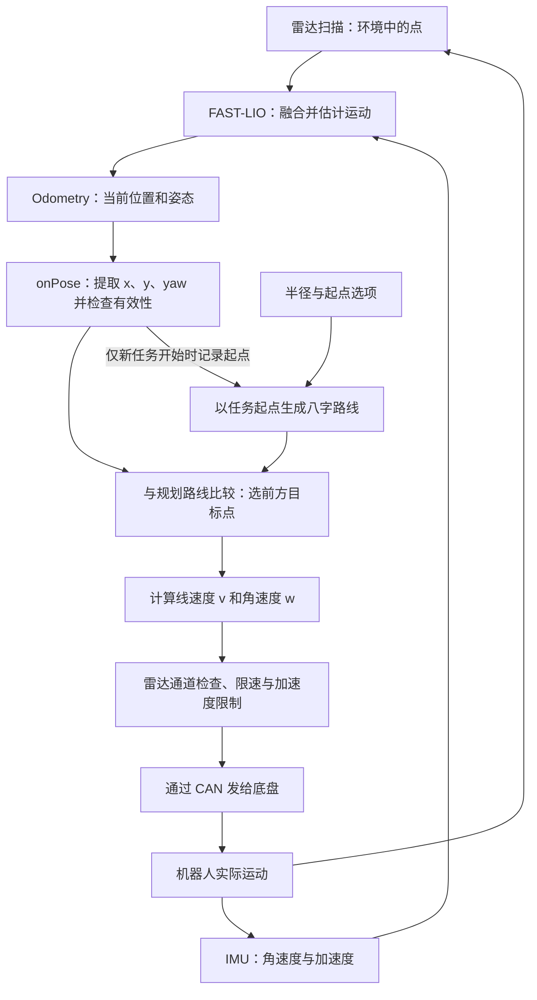

# 机器人怎样知道位置，又怎样沿着八字走

记录日期：2026-11-07。本文按当前源码解释，不修改控制行为，也不启动机器人。八字属于**实验二扩展**，此前“实验三”的称呼已更正。

先抓住一件事：**规划路线是一串“希望经过的位置”；定位不断告诉程序“现在实际在哪里”；控制器反复比较两者，计算下一小段前进速度和转向速度。** 不是把一张八字图发给底盘，也不是只按固定时间左右转。

## 1. 完整闭环



控制循环约 50 Hz。定位和点云各按自己的频率输入；网页点云约 1 Hz，只负责显示。网页刷新慢，不会把机器人避障检查也降到 1 Hz。

## 2. 雷达与 IMU 怎样得到位置

雷达测到的是很多环境点，单帧点云本身不是机器人的坐标。IMU 测到角速度、加速度，也不是直接给出可靠的绝对位置。

当前 FAST-LIO 大致做三件事：

1. 按时间把一帧雷达与对应的 IMU 数据配起来。IMU 先预测这段时间的位置、速度和姿态变化。
2. 雷达一帧不是瞬间扫完的，机器人期间会移动。程序用 IMU 推算的运动对点云做运动畸变补偿，让这一帧里的点对应到接近同一时刻。
3. 将点云与已有局部地图中的表面匹配，用点到表面的距离修正预测值。源码使用迭代误差状态卡尔曼滤波更新，不是简单把雷达与 IMU 各取一半。

融合后的状态通过 `/Odometry` 发布。当前源码写的父坐标系是 `camera_init`，子坐标系是 `body`，位置来自融合状态 `state_point.pos`，姿态用四元数表示；同时广播 `camera_init → body` 的 TF。这里的 `camera_init` 是程序给局部世界坐标系起的名字，不表示控制器必须使用相机。

代码依据：[雷达/IMU 同步、融合及发布](实验一/源码/slam_experiment/FAST-LIO-Localization/FAST-LIO-Localization-QN-master/src/third_party/FAST_LIO/src/laserMapping.cpp) 中的 `sync_packages`、`h_share_model`、`publish_odometry` 和主循环；[IMU 预测与点云补偿](实验一/源码/slam_experiment/FAST-LIO-Localization/FAST-LIO-Localization-QN-master/src/third_party/FAST_LIO/src/IMU_Processing.hpp) 中的 `Process`、`UndistortPcl`。

实验二运行脚本当前引用机器人原有工作空间的 FAST-LIO 二进制。本机这份源码用于核对原理；不能仅凭本地文件认定机器人上游二进制已重新编译为同一版本。

## 3. 控制器怎样读出 x、y、朝向

[basic_control.cpp](实验二/lab26/catkin_ws/src/basic_control/src/basic_control.cpp) 的 `onPose()` 订阅 `/Odometry`：

```text
x = pose.position.x
y = pose.position.y
yaw = atan2(2(qw·qz + qx·qy), 1 − 2(qy² + qz²))
```

`yaw` 是地面平面内的朝向角，单位为弧度。控制程序主要使用二维位置和朝向，FAST-LIO 本身仍估计三维运动。

程序检查消息时间、数值是否有限、四元数是否接近单位长度，并检查连续位置和角度有没有不合理突变。实际运行中定位超时、无效或突变，会进入故障停车；不会凭速度指令自己猜一条位置继续走。

当前控制代码**直接使用消息里的坐标**，没有在 `onPose()` 中再通过 TF 转换坐标，也没有严格校验 `frame_id`。因此它依赖当前 `/Odometry` 确实来自预期的 FAST-LIO 坐标系。更换定位来源时，不能只把话题名接上一样就认为坐标已经对齐。

## 4. 规划轨迹与实际轨迹有何区别

| 内容 | 是什么 | 当前来源 |
| --- | --- | --- |
| 规划轨迹 | 希望机器人经过的位置 | 八字生成器保存的一串二维点 |
| 实际轨迹 | 定位系统估计机器人已经走过的位置 | `/Odometry` 历史位置；它也会有定位误差 |
| 原始点云 | 雷达周围环境的点 | `/velodyne_points`，属于雷达局部坐标 |
| 配准点云 | 变换到局部世界坐标后的点 | FAST-LIO 的 `/cloud_registered` |

控制器把八字规划路线变换到**任务开始时这次 `/Odometry` 的坐标系**，运行中的实际位置也来自同一话题，因此两者可以直接比较。它没有把八字每一帧都重新移动到机器人脚下；那样目标会跟着车跑，永远走不完。

电脑目前把原始点云和实际定位轨迹分别显示，避免把两个坐标系生硬叠在一起。机器人 RViz 使用 `camera_init`，显示配准点云、`/path` 和里程计姿态。当前两个界面的轨迹线主要表示实际轨迹，**尚未发布并叠加八字规划线**。

实验一保存地图后的全局定位还有 `map` 坐标系和 `/pose_stamped`，实验二当前控制器不使用该话题。局部里程计和保存地图的全局定位不能直接混用。此外，雷达/IMU 的安装外参、`body` 参考点与底盘转动中心的偏移，也会影响实车跟踪效果；本次没有重新标定这些关系。

实际轨迹网页记录见 [trajectory.cjs](控制台/trajectory.cjs)；显示见 [cloud.js](控制台/cloud.js)；机器人显示配置见 [lab26.rviz](实验二/lab26/launch/lab26.rviz)。

## 5. 当前八字由什么公式生成

代码在 [figure_eight.h](实验二扩展/include/figure_eight.h) 的 `lab2ext::path()`。它把两个半径相同的圆拼接起来，交叉点相切，不是正弦曲线，也不是贝塞尔曲线。

先在一个临时二维坐标系中画圆，令 `a` 从 0 变化到 `2π`：

```text
第一个圆：x = R·sin(a)，y =  R·(1 − cos(a))，圆心 (0, R)
第二个圆：x = R·sin(a)，y = −R·(1 − cos(a))，圆心 (0, −R)
```

两个圆在 `(0,0)` 相接，先逆时针绕上面的圆，再顺时针绕下面的圆；在交叉点的前进切线方向一致。方向连续，但转弯曲率会在两个圆之间换号，当前没有额外生成曲率平滑过渡段。

每个圆均匀取 `n` 个角度样本：

```text
n = 2·ceil((2πR / 0.04) / 2)
```

这使相邻样本沿圆周约隔 4 cm，并保证 `n` 为偶数，方便选圆外侧的半圈位置。两个圆加上最终闭合点，总共 `2n+1` 个点，整条路线长度为 `4πR`。

### “当前位置是交叉点或外侧”怎样实现

交叉点起步，选择上面序列的第 0 个点；外侧起步，选择第 `n/2` 个点，也就是第一个圆最外侧 `(0,2R)`，再把序列循环排列，从那里出发走完整条路线。

新任务真正开始时，程序记录当前位置 `(x0,y0)` 和朝向 `yaw0`。设临时路线起点为 `q0`，每个临时点为 `q`：

```text
θ = yaw0                     交叉点起步
θ = yaw0 − π                 外侧起步，因为该处原始切线朝向 −x

X = x0 + cosθ·(qx−q0x) − sinθ·(qy−q0y)
Y = y0 + sinθ·(qx−q0x) + cosθ·(qy−q0y)
```

先减去临时起点，再旋转到当前朝向，最后平移到当前位置。这样路线的第一点就是当前位置，第一段切线就是车头朝向。

例如交叉点起步，机器人在 `(10,3)`，朝向为 `π/2`，半径 2 m：临时路线中的 `(2,2)` 会变为世界坐标 `(8,5)`。这只是说明坐标变换，不表示控制器会直接跳过前面的点去追这个点。

## 6. 怎样用实时位置追上这条路线

八字算法在 [motion.h](实验二/lab26/catkin_ws/src/basic_control/include/basic_control/motion.h) 的 `stepEight()`，属于**前视几何跟踪，采用类似 Pure Pursuit 的转向计算**，主跟踪公式不是 PD。

每个控制周期依次做：

1. 在上次进度点开始、往前最多 50 个样本的范围内，找距离当前位置最近的路线点。游标只能前进，防止到交叉点时跳到另一圈或退回起点。
2. 从这个点沿路线向前找一个目标点。前视长度为 `min(0.5, R/2)` 米。
3. 用当前真实位置到目标点的连线方向，与当前车头方向相减，得到朝向误差。
4. 据此计算速度，再经过保护和变化率限制，发给底盘。下一周期重新读取位置、重新选择目标。

设目标点与当前位置的差为 `(dx,dy)`，距离为 `d`：

```text
误差 α = wrap(atan2(dy,dx) − yaw)
wrap(a) = atan2(sin(a),cos(a))，使角度落在 −π～π

巡航 v0 = min(0.50, 0.8·0.30·R)
正常前进 v = min(v0, max(0.04, 0.5·剩余路线长度))
转向 w = clip(2·v·sin(α) / max(0.10,d), ±0.30)
```

`clip` 表示超过上限就截住。车头偏向目标点左边还是右边，由误差符号决定，因此角速度也随实时位置改变。不是按预先写死的“左转多少秒，再右转多少秒”运行。

若 `|α| > 0.8 rad`，当前实现先给 `v=0`，用 `w=clip(0.8α, ±0.30)` 原地纠正方向；这一小段是 **P 控制**。方向合适后回到前视跟踪。这里没有用八字跟踪误差的微分项。

小半径时需要降速，因为圆周运动近似满足 `w=v/R`。例如半径 0.5 m，若坚持 0.5 m/s，需要约 1 rad/s，超过当前 0.30 rad/s 上限。代码因此将小半径巡航速度降到约 0.12 m/s。

### 进度与结束

八字进度约等于 `4πR × 游标 / (样本总数−1)`，不是“离起点多远”，也不是“已经运行多少秒”。因此返回交叉点不会自动归零，也不会提前完成。只有游标已接近整条路线末端、离最终点小于 0.10 m 时，才结束停车并报 100%。离路线超过 0.8 m 或任务超时则故障停车。

## 7. 转 45° 直行、八字、手动，各用什么算法

| 路径 | 当前实际算法 |
| --- | --- |
| 实验一 | 雷达惯性建图、地图匹配定位；实验流程本身不规划自动行驶路线 |
| 实验二原地转 45° | 航向 P 项减去滤波实测角速度的 D 阻尼项，属于航向 PD |
| 实验二直行 5 m | 横向偏差修正目标航向，再用航向 PD；靠近终点时降低线速度 |
| 实验二扩展八字 | 前视点几何跟踪；大方向误差时使用 P 原地纠偏 |
| 手动 WASD | 按键给线速度或角速度目标，加限幅和变化率限制；没有沿规划路线追踪 |

实验二先设定 `目标航向 = wrap(起步航向 + π/4)`，转到误差不超过 0.025 rad 并稳定 0.5 秒，再直行。航向控制大致为：

```text
w = clip(Kp·航向误差 − Kd·滤波后的实测角速度, ±0.30)
Kp = 0.8，Kd = 0.08
```

直行还计算到目标直线的横向偏差 `ey`，将期望航向修正为：

```text
期望航向 = wrap(目标航向 − atan2(0.6·ey, 0.3))
```

沿目标方向的投影距离或离起点的平面位移达到 5 m 即完成；横向偏差超过 0.5 m 会故障。因此不能将这一版解释为“所有情况下都精确按实际轮迹长度走满 5 m”。

## 8. 速度怎样到达底盘

当前上限：自动线速度 0.50 m/s、手动 WS 1.50 m/s、角速度 0.30 rad/s。手动线加速度 0.60 m/s²，自动 0.20 m/s²，角加速度 0.60 rad/s²。[rate_limit.h](实验二/lab26/catkin_ws/src/basic_control/include/basic_control/rate_limit.h) 按实际控制周期计算：

```text
本周期速度 = 上周期速度 + clip(目标速度 − 上周期速度, ±加速度×dt)
```

保护停车和松键归零不慢慢滑到零。最后 `basic_control.cpp` 的 `send()` 将速度乘 1000 编码，发送到底盘 CAN 帧 `0x111`。这份上位代码没有实现轮子电机的内环速度 PID；底盘实际怎样驱动电机，不应从这里推断。底盘速度反馈用于状态、故障和无响应检查，规划跟踪的位置反馈主要来自 FAST-LIO。

## 9. 暂停、漂移和定位重启会怎样

- **普通暂停**：立即给零速，保留原路线、起点和游标。暂停时间不消耗任务超时；实验二 PD 的导数历史会清空，避免继续时突跳。继续时仍追原路线，不在新位置重新画八字。
- **障碍暂停**：当前运动通道 1 m 内的有效雷达点触发暂停，1.2 m 区域清空持续 2 秒后自动继续。纯倒车的后方暂停目前关闭；过滤区域和阈值见各实验说明。
- **暂停期间车被推走**：原路线保持不变。若位移构成定位跳变，或恢复后离路线太远，会故障；没有保证在任意搬动车辆之后都能接着跑。
- **缓慢定位漂移**：程序可能认为自己仍在正确路线附近，实物却偏了。当前跳变和偏差检查不能消除所有漂移，也没有外部真值保证每个半径都精确。
- **FAST-LIO 或 ROS 主服务重启**：局部坐标原点、姿态基准或订阅注册可能变化。原路线不能自动当作新坐标系下的有效路线。当前暂停控制器会尝试重新注册订阅；已有故障不会因此自动解除。重启后应重新准备、重新开始任务，让新路线以新的定位基准生成。
- **网页轨迹断段**：网页在断连、时间倒退或相邻位置跳变超过 0.5 m 时清空轨迹段，最多保留 2000 个位置点。显示清空不等于控制器已经重设任务起点。

## 10. 已实现、已验证与当前限制

已实现：当前位置生成八字、两种起点、半径校验、实时定位前视跟踪、限速、暂停恢复、路线进度和故障停车。控制台任务需先准备、再显式启动，准备结束不会自动行驶。

本地与机器人端状态机仿真覆盖 0.5、1、2、5、10 m 半径及两种起点，包含加速度限制；全部走完整条路线。独立 ROS master、独立 TCP 测试端口及 `dry_run` 的 16 项集成检查通过，包括两种八字起点的启动、进度、暂停、继续和停止。**这些是软件仿真与接口验证，没有进行实车八字运动验收。**

尚待实车确认：轮胎打滑、定位漂移、安装外参及底盘参考点偏移对跟踪的影响、小半径换向处的实际轨迹，以及暂停后恢复的现场表现。规划线叠加显示也尚未实现。

部署复查时，雷达消息可读、控制器保持零速，但最后一次检查未收到 IMU 消息，因而 `/Odometry` 未更新，`sensors_ready=false`。这是这次记录的现场状态，不是由“编译通过”能够排除的问题；不能据此宣称当前所有传感器已就绪。后续恢复情况应追加记录，不覆盖此前的测试事实。

后续恢复记录：同日完成 WASD 修复后，已再次确认雷达、定位和底盘反馈就绪、错误码为零；手动模式由机器人明确确认，验证期间始终零速。还核对了运行进程与磁盘二进制哈希一致。详见 [WASD 修复与部署核对](控制台/WASD修复与部署核对.md)。这条更新不等同于实车八字运动验收。

操作说明：[实验一](实验一/说明.md)、[实验二](实验二/说明.md)、[实验二扩展](实验二扩展/说明.md)。
